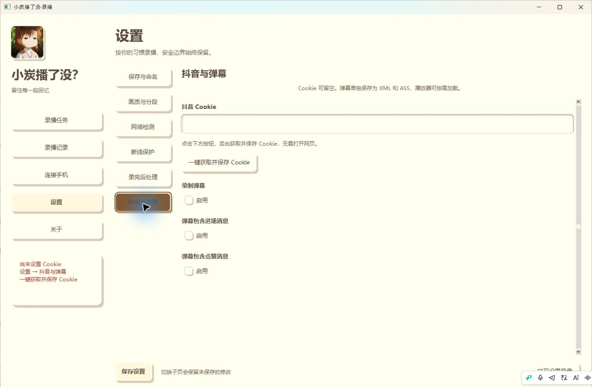
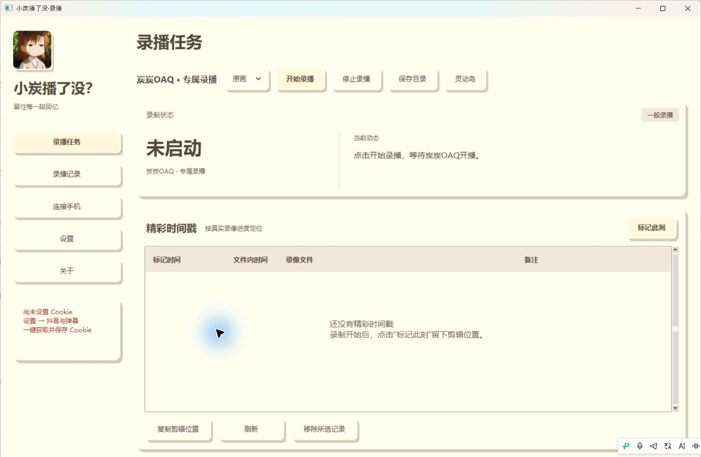
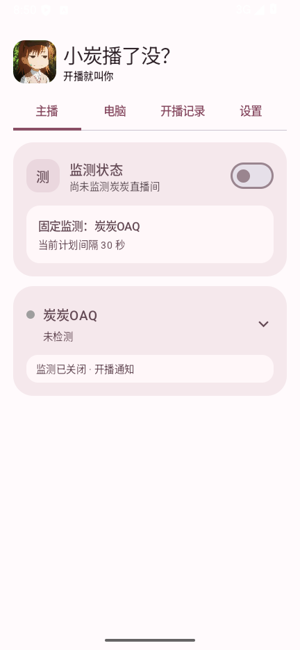
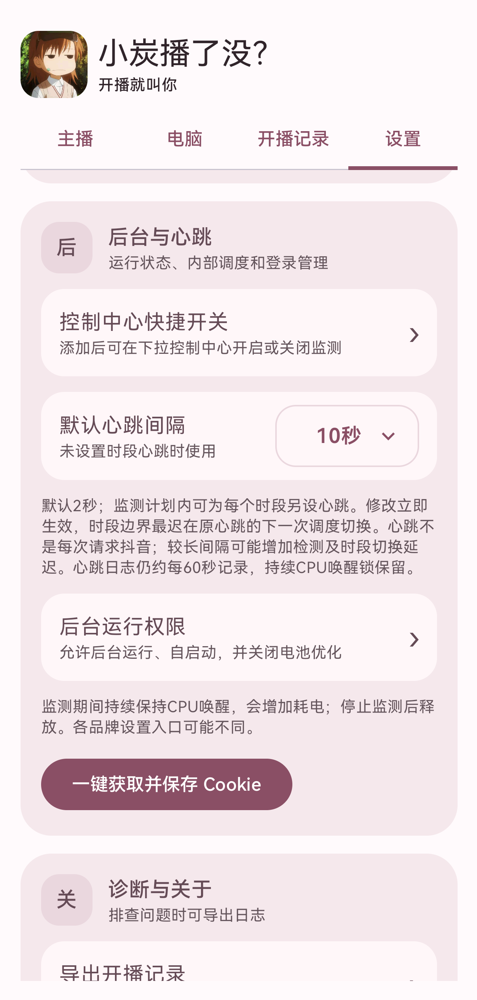
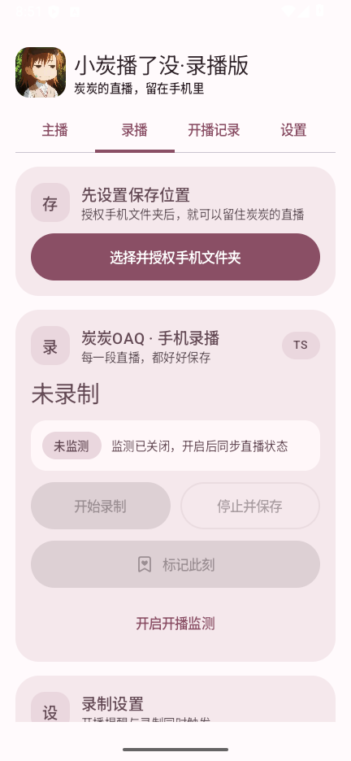
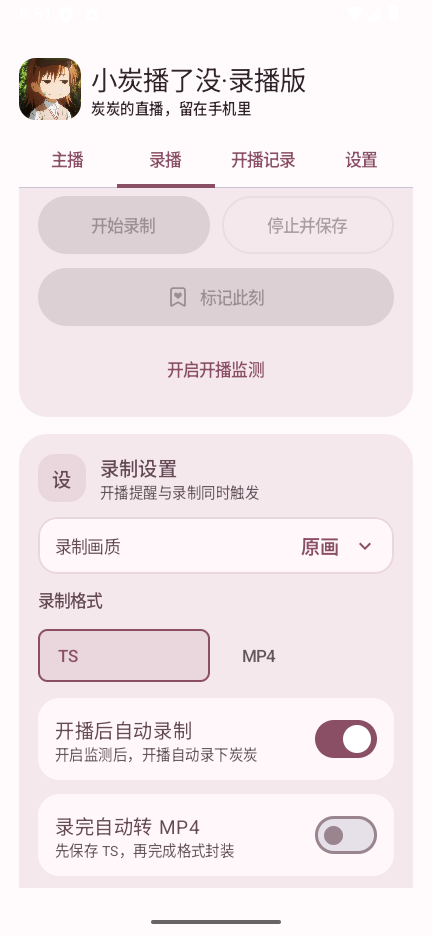
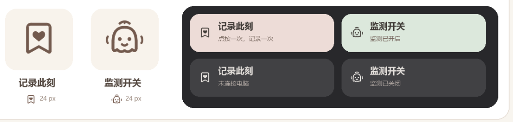

# 小炭播了没？

炭炭OAQ 专属的开播提醒和录播工具，免费下载使用。支持 Windows x64 和安卓 ARM64，暂不支持 iOS。

**[下载最新版](https://github.com/pohzhihe/xiaotan-boleme/releases/latest)**

| 版本 | 适合谁 | 下载与安装 |
| --- | --- | --- |
| Windows 电脑版 | 想用电脑录播、保存弹幕或标记精彩时刻 | 下载 Windows ZIP，完整解压后双击「小炭播了没.exe」 |
| 安卓一般版 | 想收开播提醒、查看开播记录，或用手机控制电脑录播 | 安装以 `XiaoTanBoLeMe` 开头的 APK |
| 安卓录播版 | 想收开播提醒，并把录播视频保存在手机上 | 安装以 `XiaoTanRecorder` 开头的 APK |

## 使用指南

### Windows 电脑版

1. 打开 **设置 → 抖音与弹幕**，点 **一键获取并保存 Cookie**。如果需要平台验证，按提示完成。想同时保存弹幕，可以在同一页启用 **录制弹幕** 并保存设置。
2. 到 **设置 → 保存与命名** 选择目录并保存设置。录像会按日期存放。
3. 回到 **录播任务**，选画质并点 **开始录播**。如果炭炭还没开播，软件会等待。录制中可点 **标记此刻**，结束后到 **录播记录** 查看，或点 **保存目录** 打开录像位置。

### 安卓一般版

1. 打开 **设置 → 后台与心跳 → 一键获取并保存 Cookie**。
2. 回到 **主播** 页开启开播监测，并按提示允许通知和后台运行。默认用通知提醒，历史可在 **开播记录** 查看。
3. 如果要用手机控制电脑录播，先让两台设备连接同一个局域网。在 Windows 的 **连接手机** 页开启 **允许手机连接**，再在手机的 **电脑** 页扫码或搜索，最后在电脑上同意配对。

<table>
<tr>
<td align="center"> 主页监测开关</td>
<td align="center"> 设定cookie</td>
</tr>
</table>

### 安卓录播版

1. 按 **设置 → 后台与心跳 → 一键获取并保存 Cookie** 完成首次设置。
2. 打开 **录播**，点 **选择并授权手机文件夹**，设置录像保存位置，再选择录制画质和 **TS** 或 **MP4**。
3. 想让手机在开播后自动录制，打开 **开播后自动录制** 并开启开播监测。也可以等状态显示开播后手动点 **开始录制**。录制时可 **标记此刻**，保存后在 **录播记录** 查看。

选用 TS 时，可以打开 **录完自动转 MP4**，并决定转换成功后是否保留原 TS。

<table>
<tr>
<td align="center"> 保存位置与录制控制</td>
<td align="center"> 画质、格式与自动录制</td>
</tr>
</table>

### 安卓控制中心快捷开关

1. 下拉手机控制中心并展开，点 **编辑**（部分手机显示铅笔图标）。把小炭的 **监测** 和 **记录此刻** 拖到常用区域。也可以在应用的 **设置 → 后台与心跳 → 控制中心快捷开关** 添加监测开关。
2. **监测** 用来开启或关闭开播监测。首次使用请先在应用里设置 Cookie，并按提示允许通知和后台运行。
3. **记录此刻** 在录制过程中留下时间标记。一般版需要先配对电脑，标记当前电脑的录像。录播版标记手机正在录制的录像。

